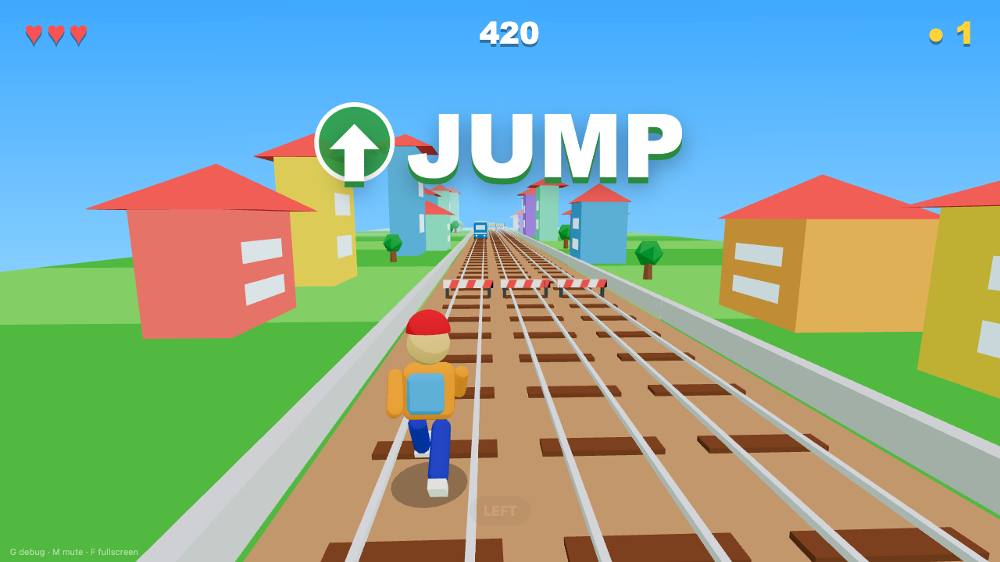
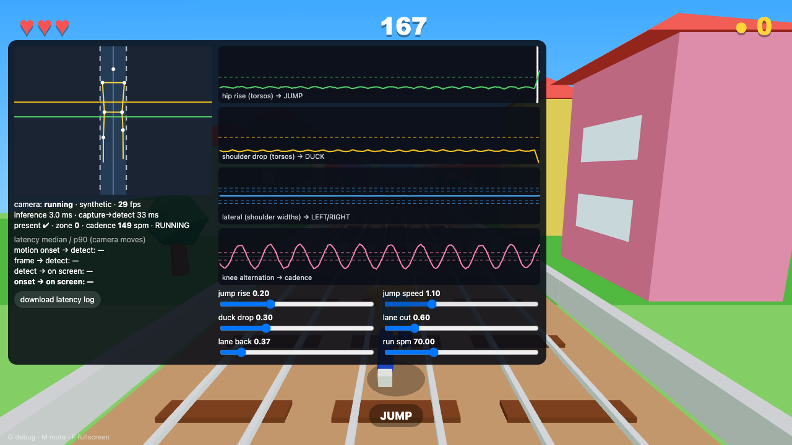

# Pocket Runner (prototype)

A Subway Surfers–style three-lane endless runner for the TV, **controlled by
your body through a webcam**. The runner always moves. You jump over hurdles,
duck under bars and step left/right to change lanes. Running on the spot is
optional: every step you take adds bonus points.



> **Change from the brief.** `PROJECT-BRIEF.md` specified a phone in your
> pocket. We switched to a **camera** (decision made 2026-10-27). That removes
> the phone, the QR join, Air Jam, the socket server, HTTPS on the LAN and
> iOS motion permissions. In exchange it adds **duck** (impossible from a
> pocket) and needs a webcam that can see you. See `FINDINGS.md`.

## Quick start

```bash
cd "TV OS/pocket-runner"
npm install          # also copies the MediaPipe WASM runtime into public/
npm run dev          # http://localhost:5173
```

Open **http://localhost:5173** in **Chrome** on the computer the webcam is
plugged into. Then put it on the TV: HDMI from a laptop is best, or cast the
tab.

For the smoothest play, use a production build: `npm run build && npm run preview`,
then open http://localhost:4173.

### Setting up the room

```
   [ TV ]
   [cam]  ← webcam (or laptop) under/over the TV, roughly waist-to-chest height
     |
     |  2–3 m
     |
    (you)   ← room for one big step left and right
```

- The camera must see you **from head to feet**. Jumps are confirmed by both
  feet leaving the floor (that's what tells a jump apart from a running step).
- Stand in the **middle third** to start.
- Light the room from the front or the side. Avoid a bright window behind you.
- Want to film from **behind**, like the viral video? Tick *"Camera is behind
  me"* on the start screen (or add `?behind` to the URL) and left/right
  will not be mirrored.

### How to play

1. **▶ PLAY WITH CAMERA** → allow camera access.
2. **Calibration (~7 s, all prompts on the TV + spoken):** stand still →
   one jump → one duck. These set your personal thresholds. Lanes need no
   calibration: they're fixed thirds of the camera picture. Press **C** to skip with defaults, **Esc** to
   restart calibration.
3. **Jump** to start (3-2-1-GO). The runner moves on its own. If you walk
   out of frame (or someone blocks you), the game **pauses** until you're
   back.
4. Follow the big prompts:

| Prompt | Body | Keyboard |
|---|---|---|
| ⬆ JUMP (hurdles) | jump | Space / ↑ / W |
| ⬇ DUCK (overhead bars) | squat | ↓ / S |
| ⬅ LEFT / RIGHT ➡ (trains) | step into the left/centre/right zone | ← → / A D |
| bonus 🏃 | run on the spot: +2 points per step | n/a |

Lanes are **the three equal thirds of the camera picture**: stand in the left
third and you're in the left lane. The picture-in-picture shows the thirds. So a missed or doubled detection
corrects itself as soon as you're standing in the right place.

You have 3 hearts. After game over, **jump** to go again, or press **R** to
recalibrate.

If someone walks behind you, the game keeps tracking **you**: it follows the
person nearest to where the player was.

### Keyboard / dev controls

| Key | Action |
|---|---|
| K (start screen) | keyboard-only mode |
| G or \` | debug overlay |
| M | mute |
| F | fullscreen |
| C (calibration) | quick calibrate from the current standing pose |

URL options: `?mainthread` (run pose detection on the main thread instead of
a Web Worker), `?delegate=gpu` (GPU inference in the worker), `?debug` (debug on at load), `?seed=abc` (same course every
time), `?input=keyboard`,
`?behind` (camera films your back), `?fake=1` (synthetic skeleton instead
of a webcam, for tests).

## Debug mode (G)



- **Camera view** with skeleton, lane zones (blue), the jump line (green) and
  the duck line (yellow).
- **Live graphs** of hip rise (jump), shoulder drop (duck), lateral offset
  (lanes) and knee alternation (cadence). Dashed lines are thresholds. White
  bars mark detected moves; the grey bar under each marks motion onset →
  detection (detection lag).
- **Sliders** tune thresholds live.
- **Latency** medians and p90s per stage, plus *download latency log* (JSON).

## How it works

```
webcam ─► MediaPipe Pose (GPU, WASM, in-browser) ─► features ─► MoveDetector ─► ControlBus ─► InputHub ─► Sim (60 Hz) ─► R3F render
            33 landmarks                         hip/shoulder/      jump, duck,    {move,seq,   lanes→abs zone,   deterministic,
                                                 centre/knees,      lanes, cadence  sentAt,...}  cadence→effort   jump/duck/grace
                                                 body-normalised
keyboard ───────────────────────────────────────────────────────────────────────► ControlBus

The runner moves at a constant, slowly increasing speed. Steps are counted for score only.
```

- **The game never sees the camera.** Camera and keyboard both produce the
  same `ControlEvent` (`src/control/types.ts`). A phone producer could be
  added later the same way (the Motion Parkour idea from the brief).
- **Detection** (`src/control/detector.ts`) normalises everything by your own
  body (torso length, shoulder width), so distance from the camera doesn't
  matter.
  - *Jump:* hips rise fast **and both feet leave the floor** (the lower ankle
    rises above its standing level for at least 2 frames). Running in place
    always keeps one foot planted, so running steps don't count as jumps.
    If the feet are out of frame it falls back to knees, then hips only.
  - *Duck:* your head drops, measured against **your own feet** (head-to-foot
    height shrinks below a fraction of standing). Walking closer to the camera
    can't fake a duck. The duck lasts **exactly as long as you're down** and
    springs back when you stand up — no timer.
  - *Lanes:* which third of the image your body centre is in, with a small
    dead band at each boundary so you don't flicker between lanes.
  - *Steps (bonus score only):* each sign change of left-knee-height minus
    right-knee-height is a step. Falls back to hip bob if the knees are out
    of frame.
  - *Multi-person:* MediaPipe tracks up to 2 people. We follow the one
    nearest the player's last position, so bystanders don't steal control.
- **Sim** (`src/sim/sim.ts`) is ported from Bull Rush: deterministic 60 Hz,
  integer maths, seeded RNG. We added Jump (0.6 s arc), Duck/slide, hurdles
  and bars, a **150 ms retroactive grace window**, and a 200 ms early-jump
  tolerance. (The sim still supports an `Effort` input for speed; the game
  no longer uses it.) The
  course is designed so the first minute is sparse and every row has a
  reachable safe lane.
- **Prompts** appear 1.5 s before each obstacle, so a move that registers up
  to ~350 ms late is still in time.

## Project layout

```
src/
  control/   camera.ts (webcam+MediaPipe), features.ts, detector.ts,
             calibration.ts, synth.ts (fake skeleton), keyboard.ts,
             bus.ts, latency.ts, types.ts (the control contract)
  game/hub.ts        control events → sim inputs
  sim/               sim.ts, runner.ts, prng.ts (+ tests)
  three/             RunScene, Player, Obstacles, World, toon materials
  ui/                Screens (setup/calibrate/ready/HUD/game over), Debug, CameraView
scripts/
  copy-mediapipe.mjs   postinstall: wasm → public/
  e2e-fake-camera.mjs  headless end-to-end run with a synthetic body
public/models/pose_landmarker_lite.task
```

## Tests

```bash
npm test             # sim + detector unit tests (vitest)
npm run build && npm run preview &   # then:
npm run e2e          # headless: calibrate + play 2 min with a synthetic body
npm run e2e -- --seconds 60 --seed e2e-2
```

## Measuring real latency (do this with a person)

The in-game log covers *motion onset → detection → on screen*. It can't see
the webcam's own capture delay or the TV's display lag. For true
glass-to-glass numbers:

1. Turn on TV **Game Mode** (it often removes 50–100 ms).
2. Film the player and the TV together with a phone in **240 fps slow-mo**.
3. Count frames from your feet leaving the floor to the character leaving the
   ground. At 240 fps, 1 frame = 4.2 ms.
4. Do 10 jumps and 10 lane changes, and record the median in `FINDINGS.md`.

## Backend?

There is none, on purpose. Camera → pose model → game all run in one browser
tab, so a move reaches the game in about 0 ms of network time. A realtime
database (Convex, Firebase, Supabase) would add a round trip of roughly
30–150 ms, so it would make latency worse, not better. It only makes sense
for features that need the network anyway: accounts, leaderboards, saved
progress, or a phone-as-controller mode.

## Tested on

- macOS, Chrome (GPU delegate), with the reference video as a fake webcam:
  30 fps, ~11 ms inference.
- Headless Chromium (SwiftShader, synthetic skeleton): full e2e.
- A real person on a MacBook webcam (2026-10-27, v1): see `FINDINGS.md`.

## Credits and licences

- Runner sim and structure ported from **Bull Rush**
  (github.com/winsznx/bull-rush, MIT). See `LICENSE` and `LICENSE-bull-rush`.
  **Code only, no assets.**
- Design idea "one small control interface + standing calibration" from
  **Motion Parkour** (github.com/1027sun/Motion-parkour_python-class-work, MIT).
- Pose estimation by **MediaPipe** (Google, Apache-2.0).
- Design comparison with the Android game *Motion Sport Games AR* (Unity/IL2CPP):
  `MOTION-GAMES-REA.md` (jump = both feet, jump is a timed arc, lateral movement
  is continuous and smoothed, single-snapshot calibration).
- All art and sound are original or generated at runtime. See `ASSETS.md`.
